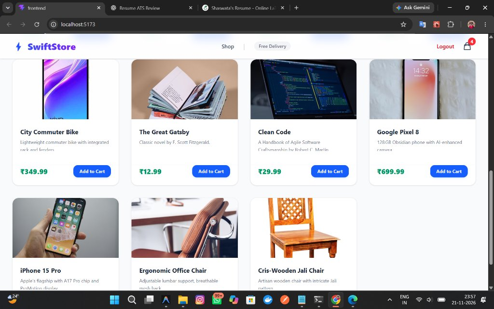
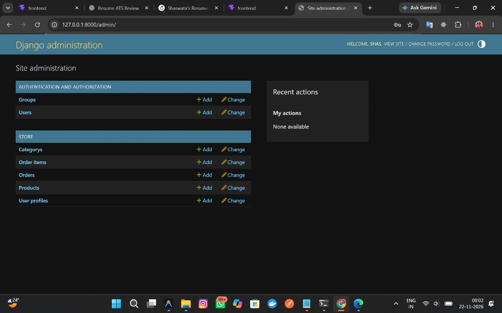

# NovaBasket

A full-stack e-commerce application built with React and Django REST Framework.

This project was built mainly as a portfolio project to practice building a decoupled web application with authentication, persistent cart management, REST APIs, and deployment.

---

## Screenshots

### Storefront / Product Catalog


### Django Administration Panel


---

## About the Project

NovaBasket consists of a React frontend and a Django REST API backend connected to a PostgreSQL database hosted on Supabase.

Some of the features include:

- User signup and login using JWT authentication
- Persistent shopping cart
  - Guests use a localStorage cart ID
  - Logged-in users keep their cart across devices
- Product browsing by category
- Simple checkout flow
- Automated welcome emails after registration
- REST API built with Django REST Framework

---

## Tech Stack

| Frontend | Backend | Database |
|----------|----------|----------|
| React 19 | Django 6 | Supabase PostgreSQL |
| Vite | Django REST Framework | Connection Pooler |
| Tailwind CSS v4 | Simple JWT | |
| React Router DOM | django-cors-headers | |

---

## Folder Structure

```text
NovaBasket/
│
├── backend/
│   ├── backend/
│   ├── store/
│   ├── media/
│   ├── manage.py
│   └── requirements.txt
│
├── frontend/
│   ├── public/
│   ├── src/
│   ├── package.json
│   └── vite.config.js
│
├── screenshots/
│   ├── storefront.jpg
│   └── django_admin.jpg
│
└── README.md
